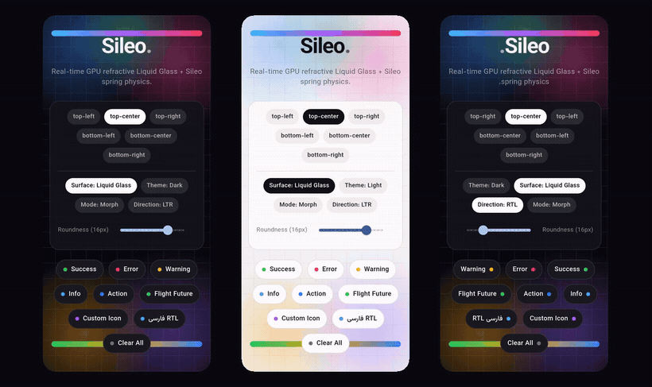
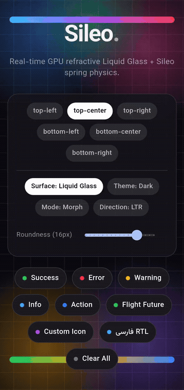
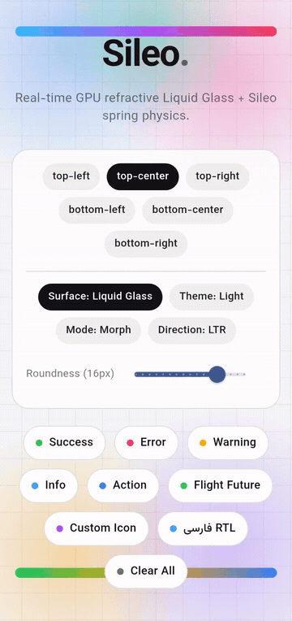
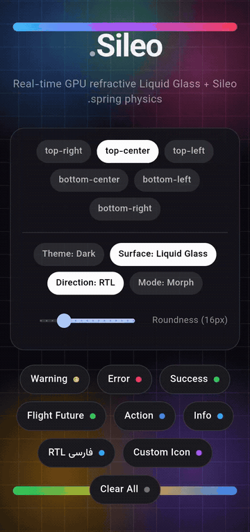
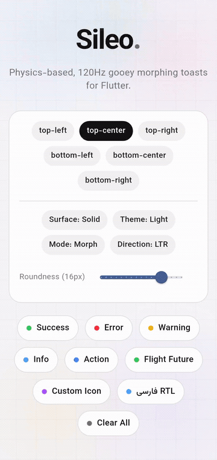

<div align="center">

# sileo_flutter

**Physics-based, gooey morphing toast notifications for Flutter — with optional real-time GPU Liquid Glass.**

[](https://github.com/aligh98/sileo_flutter/actions/workflows/ci.yml)
[](LICENSE)

Inspired by [hiaaryan/sileo](https://github.com/hiaaryan/sileo). Built for 120Hz smoothness, real spring physics, and native LTR/RTL support.

<br />



</div>

---

## Showcase

<table>
  <tr>
    <td align="center" width="25%">
      <br />
      <b>Liquid Glass · Dark</b><br />
      <sub>Flight future, action & error morphs</sub>
    </td>
    <td align="center" width="25%">
      <br />
      <b>Liquid Glass · Light</b><br />
      <sub>Multi-position & upward expansion</sub>
    </td>
    <td align="center" width="25%">
      <br />
      <b>RTL &amp; Custom Fonts</b><br />
      <sub>Vazirmatn Persian in Dark &amp; Light</sub>
    </td>
    <td align="center" width="25%">
      <br />
      <b>Solid (Default) → Glass</b><br />
      <sub>120Hz analytic gooey &amp; live toggle</sub>
    </td>
  </tr>
</table>

> **Note for X / Twitter:** Full 60fps H.264 promo clips matching these GIFs are included in [`media/twitter/`](media/twitter/).

---

## Highlights

- **120Hz Analytic Gooey Morph (Default)**: Renders the unified pill-and-card silhouette with C1-continuous cubic Bezier S-curve fillets directly via `CustomPainter` — zero offscreen blur overhead and razor-sharp edges.
- **Optional Real-Time Liquid Glass**: Switch globally (`SileoToaster(surfaceStyle: SileoSurfaceStyle.liquidGlass)`) or per toast to enable real GPU refractive Liquid Glass powered by `liquid_glass_easy`'s single-pass `LiquidGlassBlender` metaball shader, paired with high-contrast iOS 26-style typography, vibrant semantic badges, and adaptive action buttons.
- **True Spring Physics**: Powered by Flutter's `SpringSimulation` (`SpringDescription.withDurationAndBounce`), preserving instantaneous velocity across mid-flight interruptions.
- **Signature Sileo Choreography**:
  - Blur-crossfade header morphing when states or titles update.
  - Collapse-before-swap transitions when replacing an expanded toast.
  - Smooth autopilot expand/collapse delays with hover-pause (desktop) and tap-toggle (touch).
  - Vertical swipe-to-dismiss with tactile rubber-band feedback.
  - Hit-test passthrough outside the visible silhouette so underlying UI stays interactive.
- **Lightweight & Framework-Agnostic**: Works seamlessly inside `MaterialApp`, `CupertinoApp`, and `WidgetsApp`, automatically inheriting ambient fonts (`ThemeData.fontFamily` / `DefaultTextStyle`).
- **First-Class RTL & Accessibility**: Mirrors pill flow, icons, and alignment naturally under `TextDirection.rtl`, announces toasts via `Semantics(liveRegion: true)`, and respects `MediaQuery.disableAnimationsOf`.

---

## Installation

Add `sileo_flutter` to your `pubspec.yaml`:

```yaml
dependencies:
  sileo_flutter:
    git:
      url: https://github.com/aligh98/sileo_flutter.git
```

## Getting Started

Wrap your app with `SileoToaster` (for example inside `MaterialApp.builder`):

```dart
MaterialApp(
  builder: (context, child) => SileoToaster(
    position: SileoPosition.topCenter,
    // Default is SileoSurfaceStyle.solid — switch to liquidGlass anytime:
    surfaceStyle: SileoSurfaceStyle.solid,
    child: child!,
  ),
  home: const MyHomePage(),
);
```

Fire toasts from anywhere:

```dart
Sileo.success(
  title: 'Changes Saved',
  description: 'Changes saved successfully to the database.',
);

Sileo.action(
  title: 'File Uploaded',
  description: 'Share this file with your team?',
  button: SileoButton(
    title: 'Share Now',
    onPressed: () => Sileo.success(title: 'Link Copied'),
  ),
);

await Sileo.future(
  bookFlight(),
  SileoFutureOptions(
    loading: const SileoOptions(title: 'Booking Flight'),
    successBuilder: (booking) => SileoOptions(
      title: 'Booking Confirmed',
      descriptionWidget: FlightSummaryCard(booking: booking),
    ),
    error: const SileoOptions(title: 'Booking Failed'),
  ),
);
```

---

## Liquid Glass Mode

Enable real-time GPU refraction globally on `SileoToaster` or selectively on individual toasts:

```dart
SileoToaster(
  position: SileoPosition.topCenter,
  surfaceStyle: SileoSurfaceStyle.liquidGlass,
  glassOptions: const SileoGlassOptions(
    blur: 2.2,
    refractionIndex: 1.15,
    dispersion: 1.2,
    saturation: 1.22,
  ),
  child: child!,
)
```

Or per toast while keeping `SileoSurfaceStyle.solid` as your app default:

```dart
Sileo.info(
  title: 'Liquid Glass Toast',
  description: 'Real-time GPU metaball refraction on demand.',
  surfaceStyle: SileoSurfaceStyle.liquidGlass,
);
```

---

## Scoped Controllers, Stacking & RTL

- **Morph vs. Stack**: By default (`SileoStackBehavior.morph`), firing a new default toast smoothly morphs the active toast in place. Pass unique `id`s or set `stackBehavior: SileoStackBehavior.stack` to display multiple stacked toasts.
- **Scoped Controllers**: Pass an explicit `SileoController` to `SileoToaster(controller: ...)` for isolated scopes and deterministic widget tests.
- **RTL & Fonts**: `SileoToaster` automatically adapts to ambient `Directionality` (`TextDirection.rtl`) and `DefaultTextStyle` / `ThemeData.fontFamily` (see [`example/`](example/) for a complete Vazirmatn Persian RTL playground).

---

## Credits & License

- Inspired by [hiaaryan/sileo](https://github.com/hiaaryan/sileo)
- Optional Liquid Glass refraction powered by [`liquid_glass_easy`](https://pub.dev/packages/liquid_glass_easy)
- Example Persian font: [Vazirmatn](https://github.com/rastikerdar/vazirmatn) (OFL-1.1)
- Licensed under the [MIT License](LICENSE)

